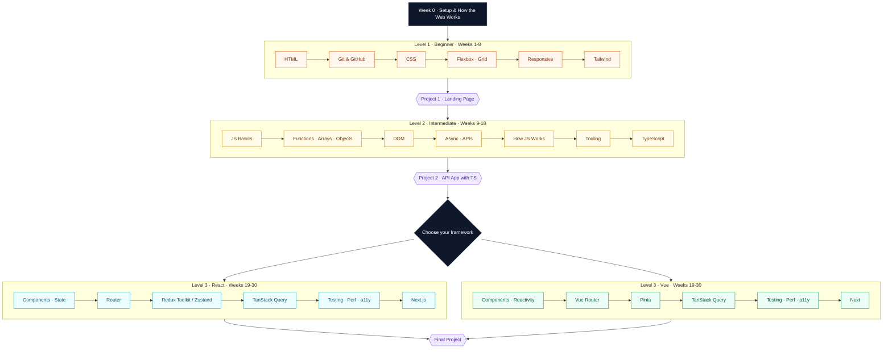

<h1>Frontend Roadmap · 2026–2027</h1>

<strong>من أول سطر HTML لحد ما تطلّع أبلكيشن حقيقي على النت</strong>

  
  
  
  

  
  
  
  
  
  
  
  
  
  

---

## الحكاية باختصار

كل موقع بتفتحه، كل زرار بتدوس عليه، كل صفحة بتتحرك قدامك بنعومة، وراها حد اشتغل **Frontend**.

الرودماب دي مش لستة لينكات وخلاص. دي **خطة أسبوع بأسبوع** على مدار سنة دراسية كاملة. كل أسبوع فيه هدف واضح، ومصدر واحد تمشي عليه، وتاسك تسلّمه، وChecklist تقولك إنت فعلاً فهمت ولا لأ.

هتبدأ وإنت مش عارف يعني إيه `
`، وهتخلص وعندك على GitHub مشاريع حقيقية **شغالة Live**، ومكتوبة بـ TypeScript و React أو Vue، ومتيستة، ومرفوعة على النت.

> **القاعدة الذهبية:** الفيديو بيعلّمك إن الحاجة موجودة. **الكود اللي بتكتبه بإيدك** هو اللي بيعلّمك إزاي تستخدمها. فلو اتفرجت ساعة، اكتب كود ساعتين.

---

## الخريطة

---

## المستويات

| المستوى | الأسابيع | هتتعلم إيه | هتخرج بإيه |
| :--- | :---: | :--- | :--- |
| **[Week 0: التمهيد](#week-0)** | 0 | النت بيشتغل إزاي، تجهيز الجهاز، إزاي تذاكر وتسأل صح | جهاز جاهز ودماغ فاهمة اللعبة ماشية إزاي |
| **[المستوى الأول: Beginner](01-beginner.md)** | 1 - 8 | HTML · Git & GitHub · CSS · Flexbox · Grid · Responsive · Tailwind | Landing Page Responsive مرفوعة Live |
| **[المستوى التاني: Intermediate](02-intermediate.md)** | 9 - 18 | JavaScript من الصفر · DOM · Async · APIs · إزاي JS شغالة من جوا · npm و Vite · TypeScript | أبلكيشن بيكلم API ومكتوب بـ TypeScript |
| **[المستوى التالت: React](03-react.md)** | 19 - 30 | React · Router · State Management · TanStack Query · Testing · Performance · a11y · Next.js | مشروع تخرج كامل بـ Next.js |
| **[المستوى التالت: Vue](03-vue.md)** | 19 - 30 | Vue 3 · Vue Router · Pinia · TanStack Query · Testing · Performance · a11y · Nuxt | مشروع تخرج كامل بـ Nuxt |

### React ولا Vue؟

الاتنين ممتازين، والأهم إنك **تختار واحد وتكمّل فيه**، ومتنطّش بينهم.

| | React | Vue |
| :--- | :--- | :--- |
| **سوق الشغل** | الأكثر طلبًا في مصر والخليج وبرا | مطلوب، خصوصًا مع شركات Laravel وفي آسيا وأوروبا |
| **منحنى التعلم** | محتاج JavaScript قوية لأن كل حاجة JS | أسهل في البداية، والـ template قريب من HTML |
| **الـ Ecosystem** | ضخم جدًا، وكل مشكلة ليها 10 حلول | أصغر بس منظم، وأغلب الأدوات رسمية |
| **الـ Meta-framework** | Next.js | Nuxt |
| **اختاره لو** | عاوز أكبر عدد فرص | عاوز تجربة أنضف وأسرع في البداية، أو شغال مع Laravel |

> مش متأكد؟ **اختار React.** ولو حبيت Vue بعدين، هتتعلمه في أسبوعين لأن المفاهيم واحدة.

---

## شكل كل أسبوع

كل أسبوع في الرودماب ماشي بنفس الترتيب، فهتتعود عليه بسرعة:

| الجزء | يعني إيه |
| :--- | :--- |
| **الهدف** | جملة واحدة: آخر الأسبوع هتكون قادر تعمل إيه |
| **المواضيع** | الكلام اللي هيتشرح |
| **المصادر** | **مصدر أساسي** تمشي عليه (عربي غالبًا)، و**بديل** لو مرتحتش للأساسي، و**مرجع** ترجعله وقت ما تحتاج |
| **التاسك** | الحاجة اللي **لازم** تعملها وتسلّمها على الداشبورد |
| **تحدي إضافي** | لو خلصت بدري وعاوز تزوّد، وده مش إجباري |
| **Checklist آخر الأسبوع** | أسئلة تسألها لنفسك؛ لو جاوبت عليها كلها من غير ما تبص، تبقى خلصت الأسبوع |
| **أخطاء شائعة** | الغلطات اللي كل الناس بتقع فيها، عشان متقعش فيها إنت كمان |
| **نصيحة منتور** | حاجة اتعلمناها بالطريقة الصعبة |

### توزيع الـ 6-8 ساعات في الأسبوع

ده اقتراح، مش قانون:

| اليوم | تعمل إيه | الوقت |
| :--- | :--- | :---: |
| يوم 1 | فيديوهات + كتابة كل كود في الفيديو بإيدك | 1.5 - 2 ساعة |
| يوم 2 | باقي الفيديوهات + تكليفات Elzero لو موجودة | 1.5 - 2 ساعة |
| يوم 3 | قراءة المرجع (MDN / Docs) في الحاجات اللي مكانتش واضحة | ساعة |
| يوم 4 | التاسك | 1.5 - 2 ساعة |
| يوم 5 | تكملة التاسك + الـ Checklist + رفع على GitHub والتسليم | ساعة |

> **مدة الفيديوهات:** جنب كل مصدر هتلاقي مدته الحقيقية. لو فيديوهات الأسبوع أكتر من 3.5 ساعة، اتفرج بسرعة **1.25x**، ولو حاجة مش واضحة رجّعها بالسرعة العادية.

> **تكليفات Elzero:** كورسات Elzero ليها تكليفات على [elzero.org](https://elzero.org) لكل مجموعة دروس، وهتلاقي لينكها في كل أسبوع. حلها **قبل** التاسك، لأنها التسخين.

---

## الـ AI في الرودماب دي

الـ AI (ChatGPT, Claude, Copilot, Cursor...) أداة قوية جدًا، بس لو استخدمتها غلط في الأول **هتطلع مبرمج مش عارف يكتب سطر لوحده**. عشان كده عندنا قواعد بتتغير مع كل مستوى:

| المستوى | المسموح | الممنوع |
| :--- | :--- | :--- |
| **Beginner** | تسأله "يعني إيه X؟" أو "اشرحلي الفرق بين X و Y" زي ما تسأل مدرس | إنه يكتبلك كود. اقفل الـ Copilot والـ autocomplete بتاع الـ AI في VS Code خالص |
| **Intermediate** | تديله الكود **بتاعك** ويقولك الغلط فين، وتطلب منه يشرحلك error | إنه يكتب حل التاسك. لو كتبلك كود، اقفله واكتبه إنت من دماغك |
| **Advanced** | تستخدمه كأداة شغل: يكتب boilerplate، ويقترح tests، ويعمل review للكود بتاعك. فيه أسبوع كامل عن إزاي تشتغل معاه زي الـ Pro | إنك تسلّم كود مش فاهم كل سطر فيه. لو المنتور سألك "السطر ده بيعمل إيه؟" ومعرفتش، يبقى التاسك مرفوض |

> **الاختبار البسيط:** لو قفلنا النت دلوقتي، تقدر تكتب الكود ده تاني؟ لو الإجابة لأ، يبقى إنت لسه متعلمتوش.

---

## Week 0: التمهيد

**الهدف:** تفهم إيه اللي بيحصل لما تكتب `google.com` في المتصفح، ويبقى جهازك جاهز تكتب عليه كود.

الأسبوع ده مش محسوب من الـ 30، وهو اللي بيفرق بين حد بيحفظ وحد فاهم.

### المواضيع

- يعني إيه Frontend و Backend و Full Stack، وإيه دور كل واحد
- الإنترنت شغال إزاي: Client و Server، و HTTP، و DNS، و IP
- إيه اللي بيحصل من ساعة ما تكتب URL لحد ما الصفحة تظهر
- المتصفح بيعمل إيه بالـ HTML و CSS و JS
- تسطيب وتظبيط VS Code
- أساسيات الـ Terminal: `cd`, `ls`, `mkdir`, `touch`
- Chrome DevTools: Elements و Console و Network
- إزاي تذاكر صح، وإزاي تسأل سؤال تقني كويس

### المصادر

| النوع | المصدر | ملاحظات |
| :--- | :--- | :--- |
| الأساسي | [كيف يعمل الإنترنت؟ - غريب الشيخ](https://www.youtube.com/watch?v=TnMNDQHB33Q) | 13 دقيقة |
| الأساسي | [شرح DNS بالعربي - IT Dose](https://www.youtube.com/watch?v=s-9143t3cHA) | 7 دقايق |
| إضافي | [What happens when you type a URL into your browser? - ByteByteGo](https://www.youtube.com/watch?v=AlkDbnbv7dk) | 5 دقايق، إنجليزي بس الرسومات بتوضح كل حاجة |
| الأساسي | [الفرق بين Front end و Back end - أحمد محمود](https://www.youtube.com/watch?v=vwvPFuh7ZDs) | 7 دقايق |
| الأساسي | [حوّل VS Code زي المحترفين - غريب الشيخ](https://www.youtube.com/watch?v=0u53L0GaPFc) | 12 دقيقة |
| الأساسي | [Learn Command Line - Elzero](https://www.youtube.com/playlist?list=PLDoPjvoNmBAxzNO8ixW83Sf8FnLy_MkUT) | ساعة |
| الأساسي | [استخدام Chrome DevTools - Elzero](https://www.youtube.com/watch?v=_IKTGQosYMo) | 12 دقيقة |
| مرجع | [How the web works - MDN](https://developer.mozilla.org/en-US/docs/Learn_web_development/Getting_started/Web_standards/How_the_web_works) | مقال قصير |
| مرجع | [An overview of HTTP - MDN](https://developer.mozilla.org/en-US/docs/Web/HTTP/Overview) | ارجعله لما تيجي في Async |
| مرجع | [Chrome DevTools Overview](https://developer.chrome.com/docs/devtools/overview) | |

### التاسك

1. سطّب **VS Code** و **Google Chrome** (أو أي متصفح Chromium) و **Git**.
2. سطّب الإضافات دي في VS Code: `Live Server`، و `Prettier`، و `Error Lens`، و `Auto Rename Tag`.
3. اعمل أكونت على **[GitHub](https://github.com)** بإيميل حقيقي، واسم احترافي (`ahmed-ali` مش `a7med_elgamed_2005`).
4. اكتب في ملف `week-0.md` إجابتك **بأسلوبك** على السؤال ده: "إيه اللي بيحصل من ساعة ما أكتب `facebook.com` لحد ما الصفحة تظهر؟" (من 10 لـ 15 سطر، و ممنوع تنسخ من AI).
5. افتح أي موقع بتحبه، وافتح DevTools، وغيّر أي نص في الصفحة من تاب Elements، وخد Screenshot.

**التسليم:** على الداشبورد: لينك أكونت GitHub + الملف + الـ Screenshot.

### تحدي إضافي

افتح تاب **Network** في DevTools واعمل Refresh لأي موقع. اكتب: كام Request اتبعتوا؟ وإيه أكبر ملف اتحمّل؟ وإيه أنواع الملفات اللي شفتها (HTML, CSS, JS, Images, Fonts)؟

<b>Checklist آخر الأسبوع</b>

 

- [ ] أقدر أشرح الفرق بين Frontend و Backend لحد مش بتاع برمجة
- [ ] أعرف يعني إيه Client و Server و Request و Response
- [ ] أعرف الـ DNS بيعمل إيه، وليه محتاجينه
- [ ] أقدر أفتح Terminal وأتنقل بين الفولدرات وأعمل فولدر جديد
- [ ] أقدر أفتح DevTools وأعدّل في الصفحة وأشوف الـ Console
- [ ] VS Code متسطب ومتظبط، و Live Server شغال

### أخطاء شائعة

- **إنك تقعد أسبوعين تختار أحسن Theme وأحسن Font لـ VS Code.** الأدوات مش هي اللي بتعلّمك. ظبّط الأساسي وابدأ.
- **إنك تسطب 40 Extension.** كل إضافة زيادة بتبطّأ المحرر وبتخبّي عنك حاجات المفروض تتعلمها.
- **إنك تفتكر الأسبوع ده "مش مهم".** كل مشكلة هتقابلك في الـ Async والـ APIs بعد كده أصلها في الأسبوع ده.

### إزاي تسأل سؤال تقني صح

لما تقف في حاجة، قبل ما تسأل المنتور أو الجروب:

1. **اقرا الـ Error كويس.** 80% من الوقت الحل مكتوب في رسالة الخطأ.
2. **ادوّر بالـ Error نفسه** على Google.
3. **جرّب حاجة لمدة 20-30 دقيقة.** لو فضلت واقف، اسأل، ومتقعدش 3 أيام واقف.
4. لما تسأل، قول: **كنت عاوز أعمل إيه** + **عملت إيه** + **حصل إيه** + **الكود والـ Error كـ text مش صورة موبايل للشاشة**.

> **نصيحة منتور:** أكتر حاجة بتفرق بين اللي بيكمّل واللي بيقف في النص هي **الاستمرارية** مش الذكاء. ساعة كل يوم أحسن من 7 ساعات يوم الجمعة. ولو فوّت أسبوع، متبدأش من الأول. كمّل من مكانك.

---

## أسئلة بتتكرر

<b>محتاج لابتوب قوي؟</b>

 

لأ. أي جهاز عليه 8GB RAM يكفي لحد آخر الرودماب. لو 4GB هيمشي في الـ Beginner والـ Intermediate، وهيتقل شوية مع React/Vue بس هيمشي.

<b>لازم أكون شاطر في الماث؟</b>

 

لأ. الـ Frontend محتاج **تفكير منطقي** أكتر من ماث. لو بتعرف تحل مسألة خطوة بخطوة، يبقى إنت تمام.

<b>الإنجليزي بتاعي ضعيف، هينفع؟</b>

 

أيوه، وعشان كده أغلب المصادر الأساسية عربي. بس مع الوقت هتلاقي نفسك محتاج تقرا Docs إنجليزي، وده طبيعي. ابدأ بالـ Docs من أول المستوى التاني، ولو مفهمتش جملة ترجمها. بعد شهرين هتلاقي نفسك بتقرا عادي.

<b>فاتني أسبوع أو اتنين، أعمل إيه؟</b>

 

متقلقش ومتبدأش من الأول. ركّز على **التاسك** و**الـ Checklist** بتوع الأسابيع اللي فاتتك، وسيب التحديات الإضافية. وكلّم المنتور بتاعك.

<b>ليه مفيش Bootstrap أو SASS؟</b>

 

لأن الـ CSS الحديث بقى فيه variables و nesting، فـ SASS بقى أقل أهمية بكتير. و Tailwind أخد مكان Bootstrap في أغلب المشاريع الجديدة، خصوصًا مع React و Vue. لو اشتغلت في شركة بتستخدمهم، هتتعلمهم في يومين لأنك فاهم CSS كويس.

<b>ليه TypeScript قبل React/Vue مش بعدهم؟</b>

 

لأن أغلب الشركات النهارده بتكتب React و Vue بـ TypeScript. فبدل ما تتعلم الـ framework بـ JS وبعدين تتعلمه تاني بـ TS، هتدخله وإنت بتكتب TS من أول يوم، زي الشغل الحقيقي بالظبط.

---

## إيه الجديد عن رودماب 2025-2026؟

| 2025-2026 | 2026-2027 |
| :--- | :--- |
| لستة لينكات مقسمة بالمواضيع | خطة **أسبوع بأسبوع** بمدة ومصدر أساسي وتاسك |
| مفيش تاسكات ولا مشاريع إلزامية | تاسك كل أسبوع + **3 مشاريع كبيرة** |
| إنجليزي | **عربي** |
| Webpack، و Bootstrap، و SASS، و Recoil، و MobX | **Vite**، و **Tailwind v4**، و **Zustand / Redux Toolkit**، و **Pinia** |
| TypeScript في الآخر كـ Advanced | **TypeScript قبل الـ framework** |
| مفيش Next.js ولا Nuxt | **أسبوعين** لـ Next.js أو Nuxt |
| مفيش كلام عن الـ AI | **سياسة AI متدرجة** + أسبوع عن الشغل معاه |

الرودماب القديمة لسه موجودة لو حبيت ترجعلها: [2025-2026 Frontend Roadmap](https://github.com/CIS-Team/2025-2026-Roadmaps/tree/main/Frontend)

---

## ابدأ دلوقتي

1. خلّص [Week 0](#week-0)
2. افتح [المستوى الأول: Beginner](01-beginner.md)
3. ومتنساش: **اكتب كود كل يوم**

---

**Maintained by [Ameen MV](https://github.com/ameenmv)** · Frontend Mentor @ CIS Team

[All CIS Team Tracks](https://github.com/CIS-Team/2026-2027-Roadmaps)

