 

  

  

**[The Map](#the-map)** · **[Levels](#levels)** · **[How a Week Works](#how-a-week-works)** · **[AI Rules](#ai-rules)** · **[Week 0](#week-0)** · **[Tracker](TRACKER.md)** · **[Resources](RESOURCES.md)** · **[FAQ](#faq)**

---

## Why this roadmap

Not a list of links. A **week-by-week plan** for a full academic year.

Every week has **one goal**, **one main source**, **one task you ship**, and **a checklist** that tells you if you actually got it. You start not knowing what a `
` is. You finish with real, tested, deployed apps on your GitHub.

> [!IMPORTANT]
> **The golden rule:** a video shows you something exists. **Code you type yourself** teaches you how to use it. Watch for 1 hour, code for 2.

<table>
<tr>
<td align="center" width="25%"><h2>31</h2>weeks, Week 0 included</td>
<td align="center" width="25%"><h2>60-75 h</h2>of hand-picked video, mostly Arabic</td>
<td align="center" width="25%"><h2>30</h2>weekly tasks you ship</td>
<td align="center" width="25%"><h2>3</h2>portfolio-ready projects</td>
</tr>
</table>

---

## The Map

<picture>
  <source media="(prefers-color-scheme: dark)" srcset="assets/roadmap-dark.svg" />
  <source media="(prefers-color-scheme: light)" srcset="assets/roadmap-light.svg" />
  
</picture>

Every number is a week. The big glowing ones are your 3 milestone projects. Jump in: [Week 0](#week-0) · [Level 1](01-beginner.md) · [Level 2](02-intermediate.md) · [React](03-react.md) · [Vue](03-vue.md)

---

## Levels

<table>
<tr>
<td width="25%" valign="top">

**Weeks 1-8** · ~23 h video

HTML · Git · CSS · Flexbox · Grid · Responsive · Tailwind

**Ship:** a responsive landing page, live.

</td>
<td width="25%" valign="top">

**Weeks 9-18** · ~23 h video

JavaScript · DOM · Async · JS internals · npm · Vite · TypeScript

**Ship:** an API-driven app in TypeScript.

</td>
<td width="25%" valign="top">

**Weeks 19-30** · ~29 h video

React · Router · Redux Toolkit · Zustand · TanStack Query · Vitest · Next.js

**Ship:** a full Next.js app.

</td>
<td width="25%" valign="top">

**Weeks 19-30** · ~15 h video

Vue 3 · Vue Router · Pinia · TanStack Query · Vitest · Nuxt

**Ship:** a full Nuxt app.

</td>
</tr>
</table>

<b>React or Vue?</b>

 

| | React | Vue |
| :-- | :-- | :-- |
| **Jobs** | Most in demand in Egypt, the Gulf, and remote | Solid demand, very common with Laravel shops |
| **Learning curve** | Needs strong JS; everything is JS | Gentler; templates feel like HTML |
| **Ecosystem** | Huge, many ways to do everything | Smaller, mostly official tools |
| **Meta-framework** | Next.js | Nuxt |

Not sure? **Pick React.** You can learn Vue in two weeks later; the ideas carry over. Just don't switch midway.

---

## How a week works

Every week follows the same layout:

| Block | What it is |
| :-- | :-- |
| **Video card** | The main video to start with. Click the thumbnail. |
| **Goal** | What you can do by the end of the week |
| **Topics** | What gets covered |
| **Practice / Read** | Elzero assignments, docs, interactive games |
| **Task** | What you build and submit on the dashboard. Required. |
| **Bonus** | Optional, for when you finish early |
| **Exit checklist** | If you can answer all of it without looking, you're done |
| **Pitfalls** | The mistakes everyone makes |
| **Mentor tip** | Things we learned the hard way |

### A suggested week (6-8 h)

| Day | Do | Time |
| :--: | :-- | :--: |
| 1 | Videos. Type every line of code yourself. | 1.5-2 h |
| 2 | Remaining videos + Elzero assignments | 1.5-2 h |
| 3 | Read the docs on what wasn't clear | 1 h |
| 4 | The task | 1.5-2 h |
| 5 | Finish the task, run the checklist, push, submit | 1 h |

> [!TIP]
> Each source shows its real length. If a week's videos run past 3.5 h, watch at **1.25x** and slow down where it gets tricky.

---

## AI rules

ChatGPT, Claude, Copilot and Cursor are powerful. Used too early, they leave you unable to write a line on your own. The rules change with your level:

| Level | Allowed | Not allowed |
| :-- | :-- | :-- |
| **Beginner** | Asking it to *explain* a concept, like a teacher | Writing code for you. Turn off AI autocomplete in VS Code. |
| **Intermediate** | Explaining an error, reviewing *your* code | Writing your task solution |
| **Advanced** | A real work tool: boilerplate, tests, reviews. Week 29 covers working with it like a pro. | Submitting code you can't explain line by line |

> [!CAUTION]
> **The test:** if the internet went off right now, could you write it again? If not, you haven't learned it yet.

---

## Week 0 · Setup & How the Web Works

<table>
<tr>
<td width="340" valign="top">

 <b>How the Internet Works</b>
 Ghareeb Elshaikh · 13 min

</td>
<td valign="top">

**Watch:** [How the Internet Works](https://www.youtube.com/watch?v=TnMNDQHB33Q) · **Ghareeb Elshaikh · 13 min**

**Goal:** understand what happens when you type `google.com`, and get your machine ready to code.

**Topics:** Frontend vs Backend · Client & Server · HTTP · DNS · How browsers render · VS Code · Terminal basics · DevTools · How to ask good questions

**Not counted in the 30 weeks.** It's what separates memorizing from understanding.

</td>
</tr>
</table>

| | Source | Length |
| :-- | :-- | :--: |
| Watch | [What is DNS? · IT Dose](https://www.youtube.com/watch?v=s-9143t3cHA) | 7 min |
| Watch | [Frontend vs Backend · Ahmed Mahmoud](https://www.youtube.com/watch?v=vwvPFuh7ZDs) | 7 min |
| Watch | [VS Code like a pro · Ghareeb Elshaikh](https://www.youtube.com/watch?v=0u53L0GaPFc) | 12 min |
| Watch | [Learn Command Line · Elzero](https://www.youtube.com/playlist?list=PLDoPjvoNmBAxzNO8ixW83Sf8FnLy_MkUT) | 1 h |
| Watch | [Chrome DevTools · Elzero](https://www.youtube.com/watch?v=_IKTGQosYMo) | 12 min |
| Extra | [What happens when you type a URL · ByteByteGo](https://www.youtube.com/watch?v=AlkDbnbv7dk) | 5 min · English |
| Read | [How the web works · MDN](https://developer.mozilla.org/en-US/docs/Learn_web_development/Getting_started/Web_standards/How_the_web_works) · [HTTP overview · MDN](https://developer.mozilla.org/en-US/docs/Web/HTTP/Overview) | |

#### Task · Get set up

1. Install **VS Code**, **Chrome**, **Git**, and **[Node.js LTS](https://nodejs.org)**.
2. VS Code extensions: `Live Server`, `Prettier`, `Error Lens`, `Auto Rename Tag`.
3. Create a **[GitHub](https://github.com)** account with a professional username.
4. In `week-0.md`, explain in 10-15 lines, **in your own words**: what happens between typing `facebook.com` and seeing the page? No AI.
5. Open any site, edit some text through DevTools → Elements, take a screenshot.

**Submit** your GitHub profile link, the file, and the screenshot on the dashboard.

> [!TIP]
> **Bonus:** open DevTools → **Network** and refresh a site. How many requests? What's the biggest file? Which file types did you see?

<b>Exit checklist</b>

 

- [ ] I can explain Frontend vs Backend to a non-programmer
- [ ] I know what Client, Server, Request, and Response mean
- [ ] I know what DNS does and why we need it
- [ ] I can navigate folders and create files from the terminal
- [ ] I can open DevTools, edit the page, and read the Console
- [ ] VS Code is set up and Live Server works

<b>How to ask a good technical question</b>

 

1. **Read the error.** Most of the time the answer is in it.
2. **Search the exact error message.**
3. **Try for 20-30 minutes**, then ask. Don't stay stuck for 3 days.
4. When you ask, include **what you wanted**, **what you did**, **what happened**, and **the code and error as text**, not a phone photo of your screen.

> [!WARNING]
> Don't spend a week picking themes and installing 40 extensions. Set up the basics and start.

> [!NOTE]
> **Mentor tip:** consistency beats talent. One hour a day beats seven hours on Friday. Missed a week? Don't restart. Continue from where you are.

<a href="#top">Top ↑</a> · <a href="01-beginner.md">Level 1: Beginner →</a>

---

## Extras

<table>
<tr>
<td width="50%" valign="top">

### [Progress Tracker](TRACKER.md)

A checklist of all 31 weeks and 3 projects. Copy it into your own repo and tick off each week as you go.

</td>
<td width="50%" valign="top">

### [Resources Hub](RESOURCES.md)

Every main course, doc, game, and free API used in the roadmap, on one page.

</td>
</tr>
</table>

---

## FAQ

<b>Do I need a powerful laptop?</b>

 

No. 8 GB RAM is enough for the whole roadmap. 4 GB works too, just slower once you reach React or Vue.

<b>Do I need to be good at math?</b>

 

No. Frontend needs logical thinking, not math.

<b>The sources are Arabic. Is my English good enough for the docs?</b>

 

Most main sources are Arabic on purpose. Start reading docs from Level 2; translate sentences you don't get. Within two months it'll feel normal.

<b>I fell behind. What now?</b>

 

Don't restart. Do the **task** and **checklist** for the weeks you missed, skip the bonuses, and talk to your mentor.

<b>Why no Bootstrap or SASS?</b>

 

Modern CSS has variables and nesting, and Tailwind replaced Bootstrap in most new projects. If a job needs them, you'll pick them up in two days because you know CSS.

<b>Why TypeScript before React/Vue?</b>

 

Most companies write React and Vue in TypeScript. Learn it first and you write the framework the way it's used at work from day one.

---

## What's new vs 2025-2026

| 2025-2026 | 2026-2027 |
| :-- | :-- |
| Topic-sorted link list | **Week-by-week plan** with goals, lengths, and tasks |
| No tasks or projects | **30 tasks + 3 milestone projects** |
| Webpack, Bootstrap, SASS, Recoil, MobX | **Vite, Tailwind v4, Zustand / Redux Toolkit, Pinia** |
| TypeScript as an advanced extra | **TypeScript before the framework** |
| No Next.js or Nuxt | **Two weeks** of Next.js or Nuxt |
| Nothing on AI | **Level-based AI rules** + an AI workflow week |
| Mostly English sources | **Mostly Arabic sources**, with official docs alongside |

Last year's roadmap: [2025-2026 Frontend](https://github.com/CIS-Team/2025-2026-Roadmaps/tree/main/Frontend)

---

### Ready? Start with [Week 0](#week-0), then open [Level 1](01-beginner.md).

 

**Maintained by [Ameen MV](https://github.com/ameenmv)** · Frontend Mentor @ CIS Team

[CIS Team on GitHub](https://github.com/CIS-Team)

